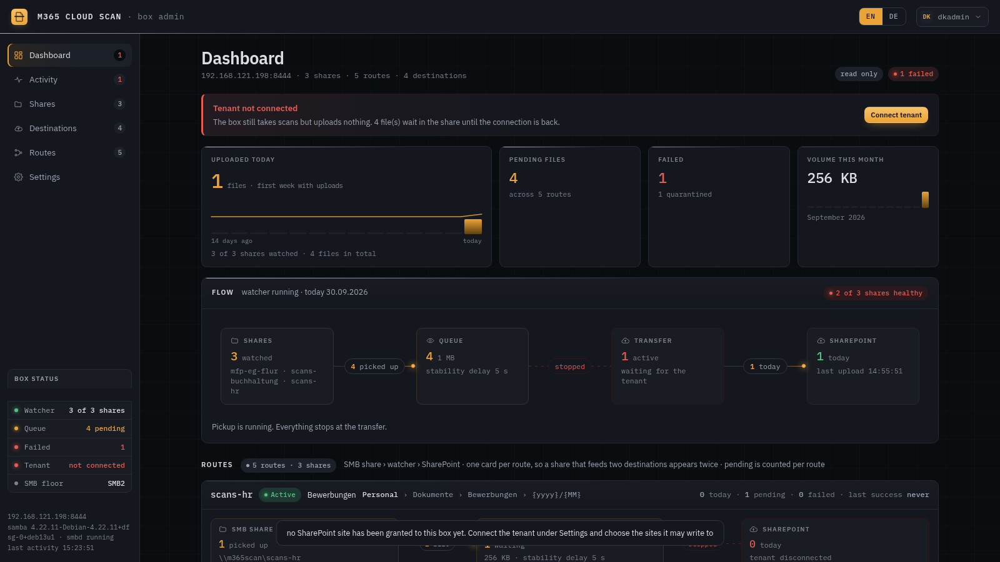
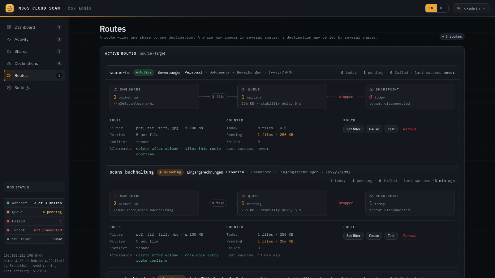

# M365 Cloud Scan

Scan-to-SharePoint for offices that still scan at the copier.

The box publishes an SMB share. The MFP's built-in "scan to folder" writes into it. A watcher notices
the new file, waits until the device has finished writing it, and uploads it to a SharePoint document
library through Microsoft Graph. Once every destination has confirmed the upload, the local copy is
deleted, so the share never becomes a filing cabinet nobody empties.

It is the sibling of [M365 Cloud Print](https://github.com/AcidDemon/m365-printing) and runs as a
second service on the same on-prem box. Admin UI on port 8444, print stays on 8443.



## Model

Three objects, managed separately, because in practice they change at different rates.

A **share** is a source: an SMB share on the box, its own service account, and the rules about which
files count (extensions, maximum size, how long a file must stop changing before it is considered
finished). A **destination** is a saved SharePoint target: site, document library, folder. A **route**
joins one share to one destination and adds the per-delivery settings: subfolder template, filename
conflict policy, retry budget.

Splitting routes out means a share can feed more than one library. The accounting scanner can drop a
copy in Finance and another in the archive without scanning twice.

That fan-out is also why deletion is a property of the file rather than of an upload. A scanned page
that gets deleted without arriving is gone, and no amount of retry logic brings it back, so the local
file survives until every route it owes a copy to has confirmed a driveItem with a matching size.
An outage (DNS, network, Graph or Entra ID busy or down) is retried after 15 seconds, doubling to every 8
minutes, for as long as it lasts. A file that cannot be delivered as it stands (Graph refuses the
destination, the file is empty, the route is gone) moves to a quarantine directory at once. Any other
failure does so once the route's retry budget is spent. The UI shows which. It never deletes.

## Setup runs in the browser

Everything tenant-specific is set up in the box's own UI, because each choice needs a decision only
the customer can make. A freshly installed box opens a five-step wizard on first sign-in: create the
scan share, say which networks may reach the box, connect Microsoft 365, pick the SharePoint site and
library, then scan one page to prove the whole chain. Any step can be skipped and finished later; a
banner on the dashboard leads back to what is missing.

Microsoft 365 is connected by device code. An administrator signs in once and grants the box write
access to the chosen sites (`Sites.Selected`). The box then registers its own app and generates its
own certificate; the private key never leaves the machine, and there is no user token to refresh.



## Network access

The box drops everything it was not told to allow. Which customer networks may reach it is edited in
the UI, on the Settings page, in two tiers: management (the admin UI and SSH) and the copiers (SMB and
name resolution). Each network is a row with a toggle per tier.

Under the hood the daemon appends plain rules into the nftables table the base firewall owns, in a
drop-in that survives a reboot and an Ansible re-run. The way back in is Tailscale, pinned by interface
rather than by address, so no edit in the UI can lock the box away from remote support. A change can be
applied with a confirm-or-revert countdown, and `m365-scan fw-reset` on the console restores the
installer's rules if someone does get shut out.

## Layout

```
cmd/m365-scan        the daemon: watcher, upload engine, admin UI
internal/model       share, destination, route, item, leg
internal/store       the JSON state file
internal/smb         Samba control through net conf and smbpasswd
internal/watch       fsnotify plus a periodic rescan
internal/engine      the upload state machine
internal/scanui      admin UI and its HTTP API, plus the firewall drop-in
internal/config      config file, env overrides, validation
pkg/graph            Microsoft Graph client
pkg/transfer         chunked resumable upload, retry and backoff
deploy/installer     unattended ISO installer and first-boot provisioning
deploy/ansible       the playbook that installs a box
deploy/dev-vm        a throwaway VM for the parts that need a real machine
scripts              the ISO builder and the workstation dev runner
```

Several packages under `pkg/` and `internal/auth` are copied from M365 Cloud Print rather than
imported. The two products ship separately and pin different Go versions, and a shared module would
couple their release cycles for the sake of about 900 lines. `pkg/transfer/download.go` is carried
along unused because it keeps the copied files byte-identical to their origin, which makes picking up
upstream fixes a matter of copying the file again.

## On the box

```
/etc/m365-scan/config.json           daemon config
/etc/m365-scan/scan.pem              Graph app certificate and key, 0600
/var/lib/m365-scan/state.json        shares, destinations, routes, queue
/var/lib/m365-scan/firewall.json     the UI-editable allowed networks
/var/lib/m365-scan/progress/         resumable upload offsets
/var/lib/m365-scan/quarantine/       files a route gave up on
/srv/m365-scan/<share>/              the share roots
/etc/nftables.d/zz-m365-scan.nft     the firewall drop-in the daemon writes
```

Samba runs with `config backend = registry`, so `smb.conf` stays static and Ansible-managed while the
web UI creates and removes shares at runtime through `net conf`. No config rewrite, no service reload.

## Installing a box

One generic installer ISO does every box. It carries no customer data, installs unattended on
arbitrary hardware, and on first boot runs the Ansible playbook against localhost, joins the tailnet
with a baked key, and prints the admin UI address and a generated password to the console. From there
the wizard takes over. `scripts/build-box-iso.sh` builds the image; `deploy/installer/` holds the
preseed and the first-boot script.

The Ansible playbook can also be driven from a control node against a fresh Debian 13 box, which is
what `deploy/ansible` documents. It installs Samba, the daemon and the systemd unit at the paths above,
seeds the Samba registry, hardens the box, and leaves it serving its admin UI with no tenant connected.
`deploy/ansible/README.md` has the commands.

## Building

```
go build ./cmd/m365-scan
go test ./...
```

There are no browser tests in this repo. What guards the admin UI instead is `internal/scanui/embed_test.go`:
it checks that the embedded page still carries its CSRF placeholder and all four base64 fonts, and that
every `$('id')` the script looks up exists in the markup. That last one matters because several of those
lookups run while the script is parsing, so a missing id kills the whole page silently.

## Running it while you work

`scripts/dev.sh` builds the daemon, prepares a throwaway box under `./.dev` with demo data in it and
serves the admin UI on https://127.0.0.1:8445. That covers UI work. It cannot create a share: a share
means `useradd`, `smbpasswd` and `net conf`, which fail on a workstation with `useradd: Permission
denied`. The shares it seeds are directories with no Samba behind them.

The port is how you tell the two apart. 8445 is always this host process, 8444 is always the VM below,
which forwards it. Both used to sit on 8444, and a browser cannot tell you which one just refused your
password. `dev.sh` now stops rather than start on a taken port.

Anything that touches a share, Samba or the systemd unit belongs in the VM under `deploy/dev-vm`. It
is Debian 13 with Samba from apt and the daemon at the production paths, so a share made in the UI is
a real system account and a real registry entry, and an MFP or `smbclient` can write into it.

```
cd deploy/dev-vm && vagrant up     # prints the admin password and both addresses
./reload.sh                        # after a Go change: rebuild, push, restart
```

See `deploy/dev-vm/README.md`.

## Third-party

The admin UI embeds IBM Plex Sans and IBM Plex Mono as base64 woff2, because the box has no outbound
internet and a webfont CDN would just hang. Both are (c) IBM Corp. under the SIL Open Font License 1.1
(https://github.com/IBM/plex). The licence notice travels with them, in a comment above the `@font-face`
block in `internal/scanui/ui/index.html`.
